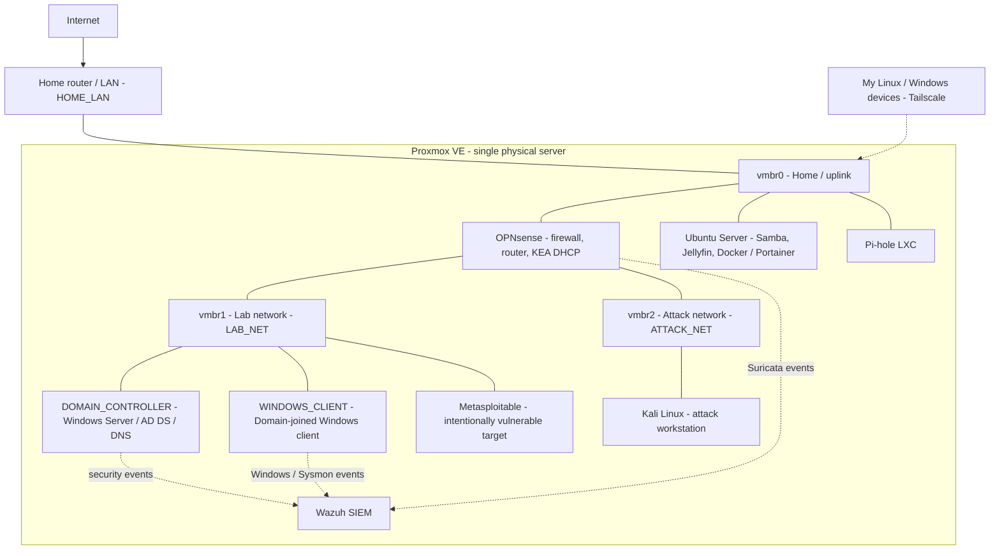

# My Cybersecurity Home Lab

**A personal Proxmox environment for learning networking, system administration, offensive security, and defensive monitoring.**

*Built and documented by Milan | Initial build completed: October 23, 2026 | Status: Base infrastructure operational; exercises ongoing*

> **Public documentation / privacy note:** This repository intentionally contains **no real host IP addresses, subnets, MAC addresses, private hostnames, public endpoints, VPN identifiers, credentials, API tokens, or private domain names**. Labels such as `LAB_NET`, `ATTACKER_HOST`, and `SIEM_HOST` are role-based placeholders, not the values used in my environment. Screenshots are only added after sanitization.

## Overview

I built this home lab because I wanted somewhere to do more than just read about cybersecurity. I wanted to configure my own network, make mistakes, troubleshoot them, generate security events, and understand what happens on both sides of an attack.

The lab runs on a repurposed PC with **Proxmox VE** as the hypervisor. It includes a virtual **OPNsense firewall**, separated attack and lab networks, Windows **Active Directory**, vulnerable targets, **Wazuh** for security monitoring, **Suricata** for network intrusion detection, and several Linux services.

This project took multiple weeks of setup and troubleshooting. By **October 23, 2026**, I had finished the initial infrastructure and verified a real detection path from an attacker-side test to a Suricata alert and a corresponding event in Wazuh. That is the milestone I mean when I say the lab is *complete*. It does **not** mean I have already performed a full penetration test, built a professional SOC, or completed the exercises in my roadmap.

I have tried to make this write-up honest and useful: not a perfect setup guide copied from the internet, but a record of what I built, what went wrong, and what I learned by fixing it.

> **Safety and scope:** This is a personal learning environment. Intentionally vulnerable systems are for authorized tests inside the lab only. I do not use these exercises against public or third-party systems.

## Contents

- [Project status at a glance](#project-status-at-a-glance)
- [What I wanted to learn](#what-i-wanted-to-learn)
- [Hardware and constraints](#hardware-and-constraints)
- [Architecture](#architecture)
- [Security boundaries and privacy](#security-boundaries-and-privacy)
- [Virtual machines and services](#virtual-machines-and-services)
- [How I built it](#how-i-built-it)
- [Monitoring and the first detection test](#monitoring-and-the-first-detection-test)
- [Problems I ran into](#problems-i-ran-into)
- [How I check that the lab works](#how-i-check-that-the-lab-works)
- [What I plan to practice next](#what-i-plan-to-practice-next)
- [Lessons learned](#lessons-learned)
- [What I would improve](#what-i-would-improve)
- [Screenshots and future documentation](#screenshots-and-future-documentation)
- [Resources](#resources)

## Project status at a glance

| Area | What is implemented | What comes next |
| --- | --- | --- |
| Virtualization | Proxmox host, VMs, LXC container, storage, and virtual bridges | Better backup/restore routine and resource monitoring |
| Network | OPNsense routing, firewall rules, DHCP, DNS, separate lab/attack segments | More structured segmentation tests and documented rules |
| Windows | Active Directory domain controller, domain-joined workstation, Group Policy | Domain security scenarios and more log analysis |
| Endpoint monitoring | Wazuh with Windows events and Sysmon telemetry | Repeatable detection and triage exercises |
| Network monitoring | Suricata on OPNsense; an SSH-scan alert was observed | More test scenarios and better incident notes |
| Attacker/target VMs | Kali and deliberately vulnerable Metasploitable | Controlled enumeration and defensive validation |
| Services and access | Ubuntu services, Pi-hole, Docker/Portainer, private remote access | Operational hardening and maintenance documentation |

I can describe the **configured infrastructure** and the **tests I actually ran**. Any items listed as future exercises are plans, not completed projects. Individual guest machines are not necessarily powered on simultaneously, because this host has limited resources.

## What I wanted to learn

My main goal was to create one environment where I could learn how infrastructure, offensive security, and defensive security fit together.

- **Virtualization and system administration:** Deploy and maintain VMs and containers, manage storage, and fix problems instead of rebuilding everything from scratch.
- **Networking:** Understand interfaces, bridges, IP addressing, DHCP, DNS, routes, and firewall rules through real configuration work.
- **Offensive security:** Use Kali Linux and deliberately vulnerable machines to practice discovery, enumeration, and controlled testing.
- **Defensive security:** Collect logs, investigate suspicious events, work with a SIEM, and see what network IDS alerts look like.
- **Windows environments:** Set up a domain controller, join a workstation to a domain, and apply Group Policy.
- **Linux and self-hosting:** Run and maintain useful services such as file sharing, a media server, DNS filtering, and containers.
- **Documentation:** Record what I built, why I built it this way, what broke, and how I fixed it, while keeping live infrastructure details private.

I am still learning. This repository is a record of a real project and a foundation for future experiments, not a claim that I have built a production-grade SOC.

## Hardware and constraints

I reused older hardware rather than buying a dedicated server.

| Component | My setup |
| --- | --- |
| Host CPU | Intel Core i5-6600K (4 cores / 4 threads) |
| Memory | 16 GB RAM |
| Primary storage | 256 GB SSD for Proxmox and VM storage |
| Additional storage | 500 GB HDD, also used for shared files |
| Hypervisor | Proxmox Virtual Environment (single physical host) |
| Networking | Linux bridges and virtual NICs; OPNsense runs as a VM |
| Remote administration | Tailscale on the Proxmox host and client devices |

**Important limitation:** 16 GB RAM and a small SSD mean I have to be careful with how many guests I run at the same time. Wazuh and Windows systems can consume substantial resources. This is a single-node lab with no high availability, and it is **not powered on 24/7**. The checks described here are observations from my setup sessions, not claims that every VM and service is continuously online.

### Storage layout

Proxmox uses a local directory store (`local`) and thin-provisioned VM storage (`local-lvm`) on the SSD. I also mounted the additional HDD for the Ubuntu-based file-sharing setup.

One of my biggest lessons came from storage: **thin-provisioned disks still need real physical space as data grows.** Running out of free blocks caused I/O errors for several VMs. I explain that below.

## Architecture

The design uses three Proxmox bridges. `vmbr0` connects to my normal home LAN. `vmbr1` hosts the internal lab network. `vmbr2` is a separate attacker-side network.

### Logical network diagram



*This is a **conceptual** diagram, not a live configuration export or a claim that every VM has the exact connections pictured. The Wazuh arrows indicate the direction of security telemetry, not physical cables or direct Layer 2 connections. The names of networks and endpoints in this diagram are intentionally generic.*

### Network layout

**Public documentation note:** The next table uses labels only. It does not include the real addressing, routing entries, interfaces on personal devices, or VPN configuration.

| Bridge / zone | Public label | Purpose |
| --- | --- | --- |
| `vmbr0` — home LAN / uplink | `HOME_LAN` | Proxmox management uplink and selected home services |
| OPNsense WAN | `HOME_UPLINK` | Upstream connectivity from the virtual firewall |
| `vmbr1` — protected lab | `LAB_NET` | Internal VMs and test targets |
| OPNsense lab interface | `LAB_GATEWAY` | Gateway for the lab network |
| `vmbr2` — attack network | `ATTACK_NET` | Separate segment for the attacking workstation |
| OPNsense attack interface | `ATTACK_GATEWAY` | Gateway between the attacker and the lab |
| Kali workstation | `ATTACKER_HOST` | Source of controlled, authorized test traffic |
| Metasploitable | `TARGET_HOST` | Deliberately vulnerable target |

I have deliberately left exact internal addresses and subnet ranges out of this public write-up. The labels `HOME_LAN`, `LAB_NET`, `ATTACK_NET`, `ATTACK_GATEWAY`, `ATTACKER_HOST`, and `TARGET_HOST` describe roles, not live addresses. Detailed IP mappings stay in my private lab notes.

**Why separate networks?** My first setups were simpler, but having Kali and the target on the same virtual bridge allowed their traffic to bypass the firewall. Moving the attacker to its own network gave OPNsense a chance to inspect the traffic between the two zones. Segmentation is only effective when routing and firewall policies enforce it; separate IP ranges alone are not a security boundary.

## Security boundaries and privacy

This lab deliberately includes machines that are **not safe to expose publicly**. Because of that, network design matters as much as the software installed on the VMs.

- **Vulnerable systems stay in a controlled lab:** Metasploitable exists to be tested, not to be accessible from the public internet.
- **Attacker traffic has a defined route:** The attacker-side and target-side zones are separated so traffic can be inspected by the virtual firewall and IDS. The main lesson here was confirming the route, not just drawing separate boxes.
- **Remote management is private:** I use Tailscale for access from my own devices; I do not publish live administrative endpoints or authentication material.
- **Not every service belongs on the same trust level:** My home services and the deliberately vulnerable lab machines serve different purposes. This diagram is a learning overview, not a certified security assessment or proof of complete isolation.
- **Sensitive technical details stay offline:** Exact IP maps, private hostnames, VPN names, account details, configuration exports, raw logs with identifying fields, and passwords are maintained in private notes.
- **Testing is authorized and local:** All attack examples in this repository refer to machines I own or have explicit permission to test.

**Important distinction:** Using multiple bridges and private addresses does not automatically guarantee isolation. Routing, firewall policy, management exposure, and whether guests have additional interfaces still have to be checked. I already learned this firsthand when Kali traffic initially bypassed the interface I expected Suricata to monitor.

## Virtual machines and services

| System | Technology | What it does in my lab |
| --- | --- | --- |
| **Proxmox VE** | Bare-metal hypervisor | Hosts and manages the virtual machines, containers, networking, and storage |
| **OPNsense** | Virtual firewall/router | Routes the lab networks, applies firewall policy, provides DHCP, and hosts Suricata |
| **Kali Linux** | Linux VM | Attack workstation for authorized security exercises |
| **Metasploitable** | Vulnerable VM | Target for learning enumeration and exploitation in an isolated lab |
| **DOMAIN_CONTROLLER** | Windows Server / Active Directory | Domain controller, AD DS, and DNS for Windows administration practice |
| **WINDOWS_CLIENT** | Windows workstation | Domain-joined endpoint used for GPO, event logging, and monitoring |
| **Wazuh** | SIEM / security monitoring | Collects and analyzes alerts and endpoint events |
| **Suricata** | IDS within OPNsense | Monitors selected network traffic and generates detection alerts |
| **Ubuntu Server** | Linux VM | Hosts services including Samba, Jellyfin, and Docker / Portainer |
| **Pi-hole** | Proxmox LXC container | DNS filtering and network-service practice |
| **Tailscale** | Private mesh VPN | Allows remote access to the homelab from my own devices |

### Windows domain and monitoring

I installed a Windows Server system named **DOMAIN_CONTROLLER**, configured Active Directory Domain Services and DNS, and joined **WINDOWS_CLIENT** to the domain. I also worked with Group Policy, including a workstation security baseline policy. Testing with tools such as `gpupdate` and `gpresult` helped me verify that policies were actually applied rather than just created in the management console.

For monitoring, I connected **DOMAIN_CONTROLLER and WINDOWS_CLIENT to Wazuh**. On WINDOWS_CLIENT, I installed **Sysmon** and confirmed Windows and Sysmon-related events appeared in Wazuh, including process-creation telemetry. This gives me an environment in which Windows administration and security monitoring can be practiced together.

### Self-hosted services

On Ubuntu Server, I configured **Samba** file sharing using the additional HDD, **Jellyfin** for a local media service, and **Docker with Portainer** for container management.

I also deployed **Pi-hole in an LXC container**. Because the server is not always running, I deliberately did **not** set Pi-hole as the router's only DNS server: doing so could leave devices at home without DNS whenever the lab was powered off.

These services are useful beyond security exercises. They give me systems to administer, update, monitor, troubleshoot, and secure.

**Separate practice machine:** I also prepared a Parrot OS laptop for TryHackMe using its VPN configuration. That laptop is part of my broader learning setup, but it is **not** one of the Proxmox VMs shown in the diagram.

## How I built it

This is the order in which the environment took shape. It describes the work I actually did without pretending that I followed one perfect installation script.

### 1. Install Proxmox and prepare storage

I installed Proxmox VE on the SSD, accessed its web interface, and started creating the first VMs. I learned the difference between the local directory storage and `local-lvm`, imported disk images, and used virtual NICs and Linux bridges to connect guests.

A few host-level checks became useful during troubleshooting:

```bash
pvesm status                 # Proxmox storage usage
lsblk                       # Disks and partitions
ip -br addr                 # Interfaces and addresses
ip route                    # Host routing table
```

These are **inspection commands**, not a complete installation script; they intentionally do not show any command output from my live network.

### 2. Create the OPNsense network

I installed OPNsense as a VM, connected its WAN side to the home LAN, and configured an internal gateway (`LAB_GATEWAY` in this public document). I worked through firewall rules, DNS, and DHCP until the lab machines could communicate as intended.

During setup, I moved DHCP configuration from **ISC DHCP to KEA** and resolved problems with leases. I also encountered a situation where DNS appeared broken even though the underlying issue involved firewall policy. That was a useful reminder to check the full path instead of assuming every failed name lookup is a DNS-server problem.

Later, I added a **second internal segment** for attacker traffic: `ATTACK_NET`, with OPNsense at `ATTACK_GATEWAY`.

### 3. Add the attack workstation and vulnerable target

I deployed Kali Linux and imported **Metasploitable** into Proxmox. Initially, Kali was connected in a way that allowed it to reach the target without going through the monitored firewall path. I eventually corrected that design by using the dedicated attack-side interface and a route toward the target network via OPNsense.

The final route followed this pattern (using redacted labels):

```text
LAB_NET via ATTACK_GATEWAY dev ATTACK_INTERFACE
```

The attacker interface and vulnerable target used separate private IP ranges. Their exact addresses are omitted here.

**Lesson:** A ping proving two machines can communicate does not prove that the traffic is passing through the firewall or IDS you expect.

### 4. Build the Windows lab

I installed the Windows Server domain controller (**DOMAIN_CONTROLLER**) and the workstation (**WINDOWS_CLIENT**), configured AD DS and DNS, and joined the client to the domain. Then I created and tested Group Policy settings.

This part of the lab is intended for understanding accounts, authentication, domain management, permissions, policies, Windows events, and later Active Directory attack-and-defense exercises.

### 5. Add Wazuh and endpoint logging

I installed Wazuh and started connecting monitored Windows systems. The Windows lab endpoints appeared as active agents during testing. I used the Wazuh dashboard and threat-hunting views to inspect events, and I added Sysmon to WINDOWS_CLIENT to provide more useful endpoint telemetry.

The setup made a big difference in how I understood SIEM tools: instead of only reading what a SIEM does, I could produce activity on a machine and find its corresponding records in the monitoring platform.

### 6. Configure Suricata and forward alerts

I enabled **Suricata** in OPNsense and worked with **Emerging Threats Open** rules. I tested packet visibility and later confirmed that an **ET SCAN Potential SSH Scan** alert appeared for traffic sent from the attack network toward the lab target.

I also configured log forwarding from OPNsense/Suricata into Wazuh. During troubleshooting, I worked on remote log forwarding and Wazuh-side parsing/alert handling until the corresponding IDS event became visible in the SIEM. Exact listener settings, integration configuration, and rule details stay in my private notes. The regular Wazuh endpoint-agent traffic is a separate channel from forwarded syslog. This allowed the IDS event to appear in the SIEM as well.

### 7. Add Linux services and remote access

I set up Ubuntu Server services (Samba, Jellyfin, Docker, and Portainer), deployed Pi-hole, and configured **Tailscale** for remote access to the Proxmox environment from my laptops.

I access the Proxmox administration interface over a private Tailscale connection rather than exposing its management service through a public port forward. Access to a specific guest service still depends on its network path, routing, and firewall permissions.

### 8. Test the complete path

My final networking work was about making sure the design behaved as intended, not just that the machines powered on. I checked the attack-side route, confirmed connectivity to the target, inspected captured traffic, and verified the network alert and its corresponding Wazuh event.

## Monitoring and the first detection test

The most useful end-to-end check so far involved an SSH-related scan signal across the two internal networks.

**Expected path:**

```text
Kali (ATTACKER_HOST)
        |
        v
OPNsense ATTACK_NET interface (ATTACK_GATEWAY)
        |
        v
OPNsense routing / inspection
        |
        v
Metasploitable (TARGET_HOST)
        |
        +--> Suricata detection --> Wazuh event
```

**What I verified:**

1. Kali had a route to `LAB_NET` through `ATTACK_GATEWAY`, rather than directly through its old lab-connected interface.
2. Connectivity to the target worked.
3. Packet capture showed the relevant traffic reaching the interface being inspected.
4. Suricata generated **`ET SCAN Potential SSH Scan`**.
5. The Suricata event was also visible in Wazuh through my configured integration.

Earlier in the setup, I had also tested the alert pipeline with temporary/custom detection logic. I removed the test rule afterward; the later Emerging Threats alert was the more meaningful confirmation.

This is a **validated detection path**, not a completed penetration test or a full incident-response investigation. My next step is to document complete exercises from initial action to alert triage, evidence, and a short report.

## Problems I ran into

This is probably the most valuable part of the project for me. The systems did not all work the first time, and a lot of the learning happened while fixing them.

### 1. VMs reported I/O errors

**Symptom:** Several guests, including Wazuh, OPNsense, and the Windows lab, stopped behaving correctly and showed an I/O error status in Proxmox.

**Cause:** The `local-lvm` thin pool on my 256 GB SSD had run out of usable space. VM disks, old snapshots, installation media, and growing data all made storage pressure worse.

**What I did:** I inspected Proxmox storage usage, cleaned up unneeded ISO images and snapshots, freed space, and later checked guest disk usage and discard/TRIM behavior. Freeing space and reviewing guest storage usage helped me recover the guests and understand why the problem affected multiple machines at once. It also pushed me to pay more attention to storage headroom instead of treating an SSD as unlimited space.

**What I learned:** Free RAM and CPU are not enough. Thin-pool capacity is a critical resource, and running it full can affect multiple VMs at once. I now treat free SSD space as something to monitor regularly.

### 2. Suricata could not see the traffic I was generating

**Symptom:** I could reach the target, but packet captures and Suricata did not show the attack traffic I expected.

**Cause:** Kali still had a direct interface on the same lab bridge as the target. Linux could use that path instead of the routed path through OPNsense.

**Fix:** I used Kali's separate interface on `vmbr2`, confirmed the route via `ATTACK_GATEWAY`, and disabled automatic connection on the interface that bypassed the firewall. After correcting the route and interface selection, the expected traffic became visible and the scan alert appeared.

**What I learned:** When a network detection rule is not firing, first verify the actual traffic path. A working IDS rule cannot inspect packets it never receives.

### 3. DHCP and DNS caused unexpected connectivity issues

I ran into DHCP leasing issues while changing from ISC DHCP to KEA, and earlier had DNS trouble related to firewall rules. I worked through interface settings, leases, gateway configuration, and policy until addressing and connectivity worked consistently.

**What I learned:** Troubleshoot layer by layer: address, gateway, route, DNS, then application. Avoid changing several unrelated settings at once.

### 4. The first IDS tests did not generate useful alerts

At first I saw no relevant alerts even after running test traffic. I had to check which interface Suricata was inspecting, whether traffic was present, how rules were enabled, and whether the log reached Wazuh.

**What I learned:** A detection pipeline has several parts, and each part needs its own test. No alert does not automatically mean no attack happened.

### 5. Remote access required more than installing a VPN

Installing Tailscale on the host and laptops made private remote connectivity possible, but I also needed to understand which services lived on the home LAN and which were behind OPNsense. A VPN connection to Proxmox does not automatically make every private subnet reachable.

**What I learned:** Remote access, subnet routing, and firewall permissions are separate problems. I prefer private access to administrative interfaces and avoid unnecessary public exposure.

### 6. Resource limits affected my decisions

With only 16 GB RAM, I cannot treat the host like an enterprise virtualization cluster. I have to choose which guests are running, manage disk growth, and avoid assuming every service can run continuously.

**What I learned:** A smaller lab can still teach real troubleshooting, networking, and detection skills. Understanding tradeoffs is part of the exercise.

## How I check that the lab works

Instead of relying on a VM showing a green *Running* status, I check whether each part does its job.

| Check | What I look for | Status at initial completion |
| --- | --- | --- |
| Proxmox administration | Host and VMs accessible; storage available | Verified |
| Lab routing | Traffic reaches `LAB_NET` through OPNsense | Verified |
| Attack-side separation | Kali uses `ATTACK_NET` route through firewall | Verified for the tested path |
| Domain services | WINDOWS_CLIENT joined to domain and GPO can be applied | Verified |
| Windows telemetry | DOMAIN_CONTROLLER / WINDOWS_CLIENT agents active; Sysmon events visible | Verified |
| Network IDS | Suricata scan alert generated | Verified |
| SIEM integration | Corresponding Suricata alert visible in Wazuh | Verified |
| Ubuntu services | Samba and Jellyfin accessible | Verified during setup |
| Remote administration | Proxmox reachable over Tailscale | Verified |
| Full incident-response playbooks | End-to-end case notes, triage, containment | Planned |

A few useful commands for diagnosing a similar **authorized lab** are below. Placeholders such as `TARGET_HOST` are not addresses; substitute values only in your own environment:

```bash
# Address and routing checks (run on the relevant Linux guest)
ip -br addr
ip route
ping -c 4 TARGET_HOST

# Traffic visibility (choose the interface that actually sees the packets)
sudo tcpdump -ni MONITORED_INTERFACE host TARGET_HOST

# Proxmox storage checks (run on the host)
pvesm status
lvs

# Example controlled SSH-port discovery against my own vulnerable lab VM
nmap -sT -p 22 TARGET_HOST
```

The command examples are **diagnostics and lab-only tests**, not a promise that every rule or alert will trigger on every version or configuration.

## What I plan to practice next

Now that the base infrastructure is ready, my plan is to use it regularly rather than keep rebuilding it.

- [ ] Document a full network discovery / enumeration exercise, including the traffic path and results.
- [ ] Investigate a Suricata alert in Wazuh and write a short SOC-style analysis: source, destination, signature, context, false-positive considerations, and next steps.
- [ ] Generate and investigate additional Windows events using Sysmon and Wazuh.
- [ ] Practice Active Directory security scenarios in the lab and document the relevant logs.
- [ ] Compare network-level (Suricata) and endpoint-level (Sysmon / Wazuh) visibility for the same exercise.
- [ ] Practice basic incident response: identify, investigate, contain in the lab, and record evidence.
- [ ] Improve VM backup and recovery procedures and document a restore test.
- [ ] Monitor Wazuh log retention and Proxmox storage growth.
- [ ] Add screenshots and individual exercise reports to this repository.

These are future tasks, **not completed achievements**.

## Lessons learned

**1. Building the environment was already part of learning cybersecurity.** I spent a lot of time on networking, Linux, Windows, storage, and troubleshooting before I could run the exercises I originally wanted to do.

**2. Understanding the path matters more than memorizing a command.** The biggest example was the IDS problem: traffic reached the target but bypassed the place where I expected to monitor it.

**3. Logs need context.** An alert is a starting point. To understand it, I need to know what generated it, which system was involved, and whether the data is reliable.

**4. Documentation is useful when something breaks.** Writing down IP ranges, interface roles, changes, and fixes saves time when I return to the lab.

**5. I do not need to know everything immediately.** My priority is to understand the fundamentals properly and then build on them through practical work. This project reinforced that mindset.

## What I would improve

If I were starting this build again, I would make a few changes to save time and make troubleshooting easier:

1. **Draw the network before deploying VMs.** I would define which guest belongs to each zone and which traffic should cross OPNsense. I learned this after accidentally letting the attacking workstation bypass the inspection path.
2. **Plan storage around logging.** Windows images, snapshots, and SIEM logs grow quickly. On a small SSD, keeping free space is part of keeping the lab working.
3. **Record every important network change.** Interface names, bridge membership, routes, firewall decisions, and the reason for each decision belong in private operational notes.
4. **Test one layer at a time.** Before troubleshooting an IDS rule, confirm addressing, the route, the physical/virtual interface, packet capture, and event forwarding.
5. **Separate 'installed' from 'validated'.** A service launching is not the same as an event reaching its dashboard or a policy applying to a Windows client.
6. **Capture sanitized evidence while testing.** It is easier to document a working alert immediately than to recreate it much later.

The next version of the lab does not have to contain more tools. It should be easier to maintain, easier to observe, and more useful for repeated experiments.

## Screenshots and future documentation

I plan to add **sanitized screenshots** of the following views as I document more exercises:

| Planned screenshot | What it will demonstrate |
| --- | --- |
| Proxmox overview | Running VMs / containers and the single-host layout |
| Proxmox network configuration | `vmbr0`, `vmbr1`, and `vmbr2` |
| OPNsense interfaces | Home, lab, and attack-side network roles |
| Windows domain / GPO | DOMAIN_CONTROLLER, WINDOWS_CLIENT, and policy verification |
| Wazuh agents | Active Windows endpoints |
| Wazuh events | Endpoint / Sysmon telemetry |
| Suricata alert | `ET SCAN Potential SSH Scan` detection |
| Wazuh Suricata event | Corresponding IDS event |
| Tailscale connectivity | Remote administration, with device and account details redacted |

I am intentionally not including fake or placeholder screenshots in the README. The repository will grow as I capture real evidence. See [the screenshot checklist](screenshots/README.md) before uploading images, and use [the exercise template](exercises/TEMPLATE.md) for future tests. Before publishing images or configuration snippets, I will remove secrets, authentication keys, exact internal network addressing, identifying information, and any details that unnecessarily expose access to my home network.

### Repository organization

```text
my-cybersecurity-homelab/
├── README.md                 # Overview, architecture, build notes, lessons
├── .gitignore                # Helps avoid accidentally staging local secrets and VM files
├── screenshots/
│   └── README.md             # Sanitization checklist and screenshot plan
└── exercises/
    ├── README.md             # Exercise index and suggested process
    └── TEMPLATE.md           # Reusable exercise report template
```

## Resources

Official documentation I use or keep as a reference:

- [Proxmox VE Documentation](https://pve.proxmox.com/pve-docs/)
- [OPNsense Documentation](https://docs.opnsense.org/)
- [Wazuh Documentation](https://documentation.wazuh.com/current/)
- [Suricata Documentation](https://docs.suricata.io/)
- [Tailscale Documentation](https://tailscale.com/kb)
- [TryHackMe](https://tryhackme.com/)
- [GitHub guide: removing sensitive data from a repository](https://docs.github.com/en/authentication/keeping-your-account-and-data-secure/removing-sensitive-data-from-a-repository)

---

## Closing thoughts

This started as an idea to turn an older PC into a place where I could practice cybersecurity. It ended up teaching me much more about virtualization, networking, Windows and Linux administration, logging, and troubleshooting than I expected.

The base lab is complete, but **the project is not finished**. From here, the goal is to run controlled exercises, investigate what happens, improve my setup, and document what I learn.

If you are building something similar, my biggest suggestion is to understand **why** a configuration works instead of only copying the steps. Fixing the things that went wrong taught me just as much as the parts that worked immediately.

*— Milan Nikolić*
